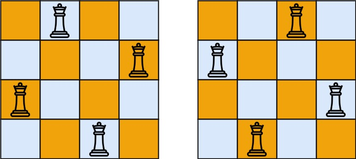
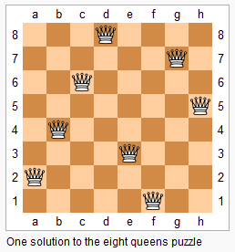
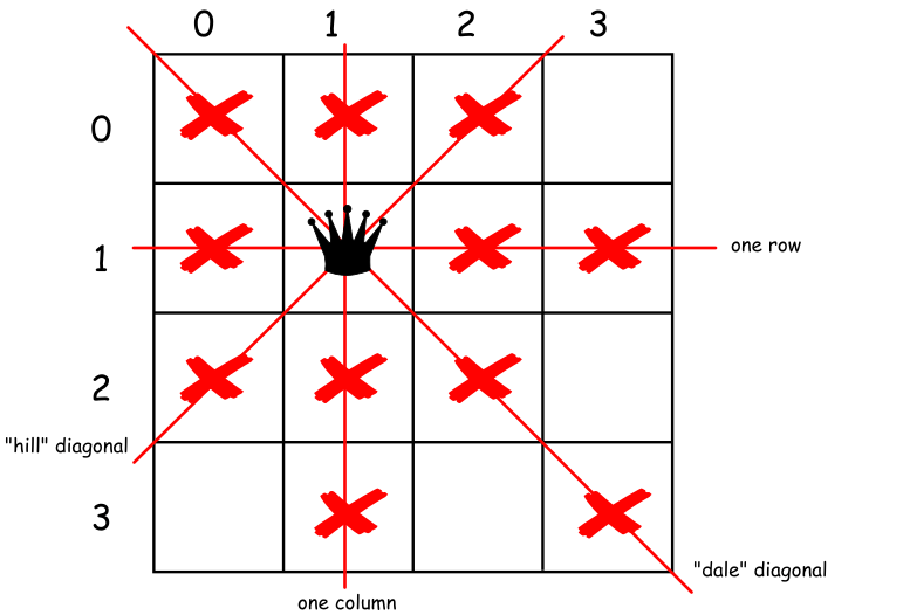
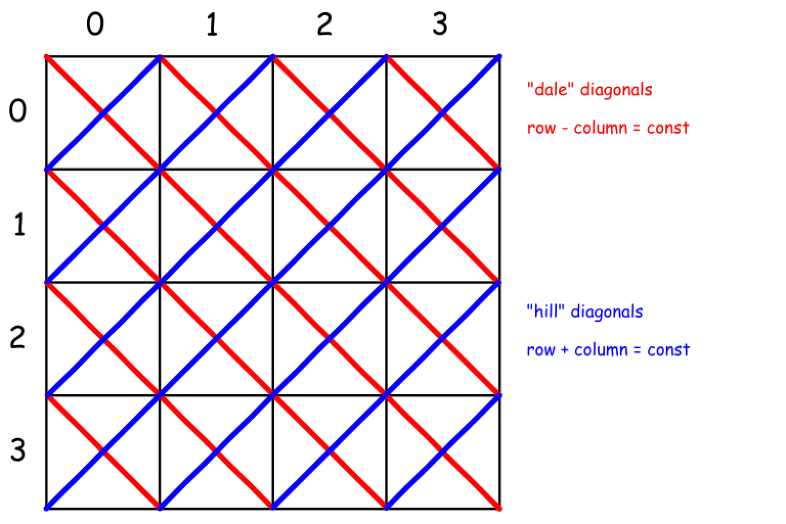
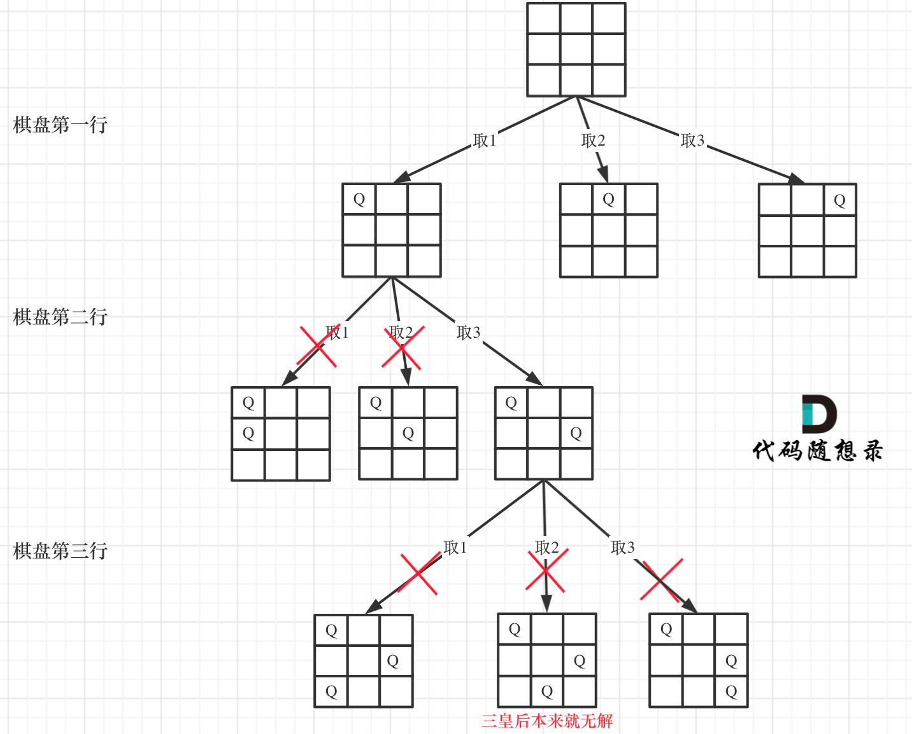

[#0051-n-queens]
= 51. N 皇后

https://leetcode.cn/problems/n-queens/[LeetCode - 51. N 皇后^]

按照国际象棋的规则，皇后可以攻击与之处在同一行或同一列或同一斜线上的棋子。

*N 皇后问题* 研究的是如何将 `n` 个皇后放置在 `n×n` 的棋盘上，并且使皇后彼此之间不能相互攻击。

给你一个整数 `n` ，返回所有不同的 *N 皇后问题* 的解决方案。

每一种解法包含一个不同的 *N 皇后问题* 的棋子放置方案，该方案中 `Q` 和 `.` 分别代表了皇后和空位。

*示例 1：*

....
输入：n = 4
输出：[[".Q..","...Q","Q...","..Q."],["..Q.","Q...","...Q",".Q.."]]
解释：如上图所示，4 皇后问题存在两个不同的解法。
....

*示例 2：*

....
输入：n = 1
输出：[["Q"]]
....

*提示：*

* `+1 <= n <= 9+`

== 思路分析

八皇后问题是回溯思想的经典题目。

当在棋盘上放置了一个皇后后，立即排除当前行，列和对应的两个对角线。这里有一点可以优化：**我们从上向下进行尝试，所以，只需要判断当前行以上的相关节点是否冲突即可。**另外，先检查再渐进点，合适之后，再向前走，可以做到有效地剪枝。

这里有个知识点需要注意：

对于所有的主对角线有 `行号 + 列号 = 常数`； +
对于所有的次对角线有 `行号 - 列号 = 常数`。 +
如下图所示：

利用回溯解题时，只回溯一半，然后将每个解反转即可求得另外一般解。这里有个细节需要注意：**如果长度是奇数，而且第一行中间是合法位置，则在回溯过程中已经产生了对称解法。就不需要再反转了。**。

[[src-0051]]
[tabs]
====
一刷::
+
--
[{java_src_attr}]
----
include::{sourcedir}/_0051_NQueens.java[tag=answer]
----
--

二刷::
+
--
[{java_src_attr}]
----
include::{sourcedir}/_0051_NQueens_2.java[tag=answer]
----
--

三刷::
+
--
[{java_src_attr}]
----
include::{sourcedir}/_0051_NQueens_3.java[tag=answer]
----
--
====

== 参考资料

. https://leetcode.cn/problems/n-queens/solutions/2079586/hui-su-tao-lu-miao-sha-nhuang-hou-shi-pi-mljv/[51. N 皇后 - 排列型回溯，简洁高效！^]
. https://leetcode.cn/problems/n-queens/solutions/398929/nhuang-hou-by-leetcode-solution/[51. N 皇后 - 官方题解^]
. https://leetcode.cn/problems/n-queens/solutions/2566744/dai-ma-sui-xiang-lu-leetcode51nhuang-hou-hcat/[51. N 皇后 - 代码随想录^]

